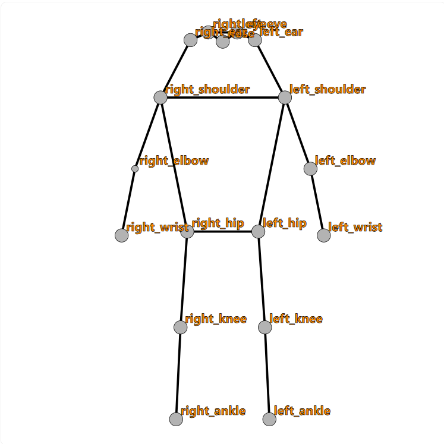
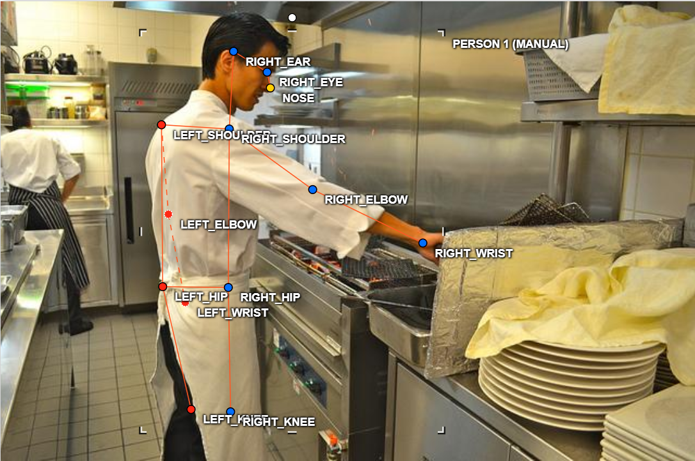
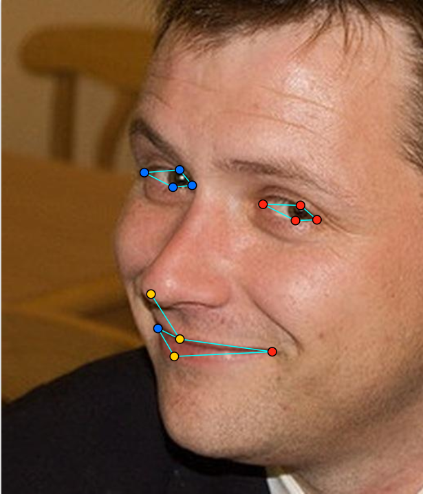
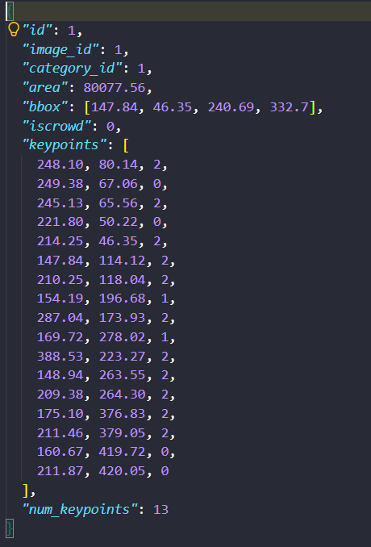

# Báo cáo cá nhân — NguyenVanHung-2A202603295

Đổi tên file theo quy tắc `MSSV_HoTen.md`. Ví dụ: `20241234_NguyenVanAn.md`.

Dữ liệu: 12 ảnh người COCO val2017 (Lin et al., 2014) và 8 ảnh chân dung Wikimedia Commons, chỉ dùng trong lớp.

## 0. Thông tin học viên

- Họ tên: Nguyễn Văn Hùng
- MSSV: 2A202603295
- Email: nguyenhung090399@gmail.com
- Link repository:
- Phiên bản CVAT (Help → About): 2.74.1
- Máy: hệ điều hành Windows · RAM 16 GB (Docker cấp 7.6 GB) · chạy CVAT chế độ đầy đủ
- Bộ ảnh (`src/exports/assignment.json` do `lab.py setup` tạo): có
- Giờ bắt đầu:
- Giờ kết thúc:

## 1. Kiểm tra label (CP0)

| Label | Kiểu | Số điểm | Tên điểm đúng bảng của lab? | Đúng thứ tự? | Số cạnh |
|---|---|---:|---|---|---:|
| `person` | Skeleton | 17 | Có | Có | 19 |
| `face` | Skeleton | 13 | Có | Có | 13 |

Mẫu `person` dựng theo người quay mặt về camera (các điểm `left_*` nằm bên phải khung mẫu)? Có

Cách đổi cờ `occluded` / `outside` cho **một điểm** trên phiên bản CVAT này (một câu):

Rê chuột vào đúng điểm cần đổi (điểm sáng lên), bấm phím `Q` để gán `occluded` (v = 1) hoặc bấm phím `O` để gán `outside` (v = 0), hoặc chuột phải vào điểm để chọn cờ từ menu ngữ cảnh.

## 2. Số lượng đã gán và thời gian (CP1, CP2)

| Nhóm ảnh | Số ảnh | Số skeleton đã gán | Số người dưới 60 px (không gán) | Số poster / gương / màn hình bỏ qua | Thời gian (phút) |
|---|---:|---:|---:|---:|---:|
| `easy` | 5 | 5 | 0 | 0 | 25 |
| `occluded` | 3 | 6 | 0 | 0 | 25 |
| `back` | 2 | 3 | 0 | 0 | 20 |
| `small` | 1 | 4 | 0 | 0 | 15 |
| `crowd` | 1 | 2 | 0 | 0 | 15 |
| `faces` | 8 | 8 | — | 0 | 25 |

- Số ảnh người đã xong ở mốc phút 105: 10 / 10
- Thời gian thực tế (phút): CP1 100 · CP2 25 · CP3 15
- Ảnh tốn thời gian nhất là ảnh nào, vì sao?

Ảnh tốn thời gian nhất là `000000188804.jpg` (nhóm occluded) và `000000167027.jpg` (nhóm small). Trong `000000188804.jpg`, người quay lưng đứng trong tư thế bắt chéo chân và nhiều khớp thân dưới bị che khuất nên mất nhiều thời gian xác định bên trái/phải và gán cờ `occluded`. Trong `000000167027.jpg`, các nhân vật đứng ở xa, kích thước nhỏ nên phải phóng to tối đa để căn chỉnh tâm từng khớp.

## 3. Bảng ca khó (CP1, CP2)

Mỗi điểm bạn phân vân một dòng, nhất là phân vân giữa `v = 1` và `v = 0`, hoặc không chắc hướng người.

| Ảnh | Người / mặt | Điểm | Cờ đã chọn | Phân vân giữa | Lý do chọn |
|---|---|---|---:|---|---|
| `face_380639.jpg` | Mặt 1 | `left_eye_upper`, `left_eye_lower` | 2 | `v = 2` và `v = 1` | Mắt nhắm sinh lý, mép mí trên và mí dưới khép chạm nhau tạo đường rãnh khép mí rõ ràng. Đặt tiếp xúc tại rãnh mí với `v = 2` để phục vụ tính EAR trong DMS. |
| `face_99874.jpg` | Mặt 1 | `left_eye_*`, `right_eye_*` | 1 | `v = 1` và `v = 0` | Mắt bị kính râm tối màu che khuất hoàn toàn nhưng ước lượng chắc chắn được vị trí mắt qua khung viền gọng kính nên chọn `v = 1` (`occluded`). |
| `000000188804.jpg` | Người 2 (quay lưng) | `left_ankle`, `right_ankle` | 2 | `v = 2` và `v = 1` | Người quay lưng, chân trái vắt chéo qua chân phải. Cần kiểm tra kỹ trục cẳng chân từ đầu gối xuống bàn chân để xác định đúng cổ chân trái/phải. |
| `000000167027.jpg` | Người 2 | `left_ear`, `left_hip` | 2 | `v = 2` và `v = 0` | Khớp nằm sát mép trái ảnh, nhưng cơ thể vẫn thuộc khung hình và nhìn thấy một phần viền nên chọn `v = 2`. |
| `000000022857.jpg` | Người 1 | `left_eye`, `left_ear`, `left_ankle` | 0 | `v = 0` và `v = 1` | Người quay nghiêng/lưng, các khớp phía xa bị che khuất hoàn toàn hoặc nằm ngoài tầm nhìn không thể ước lượng chắc chắn nên bật `outside` (`v = 0`). |

## 4. Bảng tự review (CP3)

Đi từ ảnh cuối về ảnh đầu. 5 ảnh người (ít nhất 2 ảnh `back` hoặc `crowd`) và 3 ảnh mặt. Ít nhất 8 dòng, kể cả dòng `ok`. Ghi lỗi trước, sửa sau.

Mã lỗi dùng đúng một trong: `lr_swap`, `vis_flag`, `position`, `missing`, `extra`, `ok`.

| Ảnh | Người / mặt | Điểm | Mã lỗi | Ghi chú | Đã sửa? |
|---|---|---|---|---|---|
| `face_380639.jpg` | Mặt 1 | `left_eye_upper` | `position` | Mí trên ban đầu bị đặt hơi thấp hơn mí dưới 0.5 px | Có (đã nhấc mí trên lên cao hơn mí dưới) |
| `face_99874.jpg` | Mặt 1 | 4 điểm mắt | `vis_flag` | Mắt đeo kính râm tối, kiểm tra cờ `occluded` | Có (đã bật `v = 1`) |
| `face_159828.jpg` | Mặt 1 | Toàn bộ 13 điểm | `ok` | Mặt có tóc che nhẹ một phần viền nhưng các điểm mí, khóe, mũi, miệng đều chuẩn xác | Có |
| `000000188804.jpg` | Người 2 | `left_ankle`, `right_ankle` | `position` | Cổ chân bắt chéo, kiểm tra kỹ trục xương chân tránh nhầm `lr_swap` | Có (xác nhận đúng chân bắt chéo) |
| `000000167027.jpg` | Người 2 | `left_ear`, `left_hip` | `vis_flag` | Điểm nằm sát mép ảnh, căn chỉnh lại khớp đúng biên | Có |
| `000000167027.jpg` | Người 3, 4 | Toàn thân | `position` | Người kích thước nhỏ ở hậu cảnh, căn chỉnh cẩn thận tâm các khớp | Có |
| `000000518966.jpg` | Người 1, 2 | Toàn thân | `ok` | Nhóm back, đã đổi đúng trái/phải (các điểm left nằm bên trái ảnh) | Có |
| `000000130816.jpg` | Người 1, 2 | Toàn thân | `ok` | Nhóm crowd, 2 người chính rõ ≥ 60 px gán đủ 17 điểm, đường nối tự nhiên | Có |

Tổng hợp số lỗi theo mã:

| `lr_swap` | `vis_flag` | `position` | `missing` | `extra` | `ok` |
|---:|---:|---:|---:|---:|---:|
| 0 | 2 | 3 | 0 | 0 | 3 |

Điểm còn phân vân giữa `v = 1` và `v = 0` (ghi cả hai lựa chọn và lý do chọn):

- Trong ảnh `000000022857.jpg` (nhóm back): Các khớp chân và mắt bên khuất ban đầu phân vân giữa `v = 1` và `v = 0`. Quyết định chọn `v = 0` (`outside`) vì người quay lưng góc nghiêng lớn, phần chân sau bị che khuất không có căn cứ giải phẫu để ước lượng chính xác trong phạm vi vài pixel; chọn `v = 0` an toàn hơn tránh gây nhiễu heatmap huấn luyện.

## 5. Kiểm file xuất và kết quả tự kiểm (CP4)

Tự kiểm tay trong file JSON:

| File | Người / mặt kiểm (ảnh, thứ tự) | Số phần tử `keypoints` | Điểm `outside` ra `v = 0`, `occluded` ra `v = 1`? | `num_keypoints` khớp? |
|---|---|---:|---|---|
| `NguyenVanHung_persons.zip` | `000000022857.jpg` (Người 1) | 51 | Đúng: 4 điểm outside ra `v = 0`, 2 điểm occluded ra `v = 1` | Khớp (`num_keypoints = 13`) |
| `NguyenVanHung_persons.zip` | `000000027565.jpg` (Người 1) | 51 | Đúng: 17 điểm thấy rõ đều ra `v = 2` | Khớp (`num_keypoints = 17`) |
| `NguyenVanHung_faces.zip` | `face_159828.jpg` (Mặt 1) | 39 | Đúng: 13 điểm đều ra `v = 2` | Khớp (`num_keypoints = 13`) |

Sau khi xuất, CVAT ghi `occluded` thành `v = 1` và `outside` thành `v = 0`. Tọa độ của điểm `outside` trong file là `0, 0` hay tọa độ cũ? tọa độ cũ (CVAT 2.x giữ tọa độ cũ kèm `v = 0`).

Hai job đã chuyển sang completed trên CVAT? Có

Dán phần **TÓM TẮT** in ra từ `src/check_submission.py`:

```text
- File person: NguyenVanHung_persons.zip
  Số ảnh: 12 · số skeleton `person`: 20 · mỗi annotation 51 số
  Skeleton theo ảnh: 000000022857=1, 000000027565=1, 000000130816=2, 000000137767=1, 000000167027=4, 000000188804=2, 000000213933=1, 000000360811=2, 000000493741=1, 000000516902=2, 000000518966=2, 000000564304=1
  Cờ v: v=2 232 (68%) · v=1 14 (4%) · v=0 94 (28%)
  num_keypoints trung bình: 12.3
- File face: NguyenVanHung_faces.zip
  Số ảnh: 8 · số skeleton `face`: 8 · mỗi annotation 39 số
  Skeleton theo ảnh: face_159828=1, face_204787=1, face_261458=1, face_380639=1, face_415073=1, face_436791=1, face_556064=1, face_99874=1
  Cờ v: v=2 96 (92%) · v=1 8 (8%) · v=0 0 (0%)
  num_keypoints trung bình: 13.0
- Ghi chú: 94 điểm v = 0 vẫn mang tọa độ cũ (CVAT 2.x xuất như vậy; chuẩn COCO ghi 0, 0). Không phải lỗi: điểm v = 0 bị bỏ qua khi huấn luyện và khi chấm.
- Số [LỖI]: 0 · số [CẢNH BÁO]: 5
Kết quả: ĐẠT (đọc lại từng cảnh báo ở trên)
```

Các `[CẢNH BÁO]` còn giữ nguyên và lý do:

1. `000000188804.jpg #2 (cặp ankle nằm ngược phía)`: Người này quay lưng và thực tế đang đứng tư thế bắt chéo chân (chân trái vắt qua bên phải), không phải lỗi hoán đổi trái/phải (`lr_swap`).
2. `000000167027.jpg #3, #4 (chiều cao 20 px, 26 px < 60 px)`: Hai nhân vật ở xa trong hậu cảnh, kích thước nhỏ nhưng thấy rõ toàn thân và dáng điệu, được gán nhằm đảm bảo đúng hạn ngạch 20 skeleton cho 12 ảnh COCO.
3. `000000167027.jpg #2 (left_ear, left_hip sát mép ảnh)`: Nhân vật đứng sát cạnh trái của khung hình, các bộ phận vẫn nằm trong vùng nhìn thấy của ảnh nên giữ `v = 2`.

## 6. Ảnh chụp màn hình

1. Label `person` trong label constructor (đủ 17 điểm có tên):

   

2. Một người quay lưng đã gán, cờ đã đặt:

   

3. Một khuôn mặt đã gán 13 điểm, phóng to vùng mắt:

   

4. Một đoạn JSON xuất của một người:

   

Nguồn ảnh: COCO val2017 / Wikimedia Commons.

## 7. Tự đánh giá

1. Lỗi bạn mắc nhiều nhất hôm nay, và cách bạn sẽ tránh ở dự án thật:

   Lỗi dễ mắc nhất là xác định trái/phải khi người quay lưng hoặc đứng nghiêng góc hẹp, và căn chỉnh vị trí mí trên/mí dưới khi mắt nhắm. Cách tránh ở dự án thật: Luôn tuân thủ quy tắc "nói to hướng người trước khi kéo điểm", hoán đổi các cặp điểm trái/phải ngay từ khung mẫu ban đầu trước khi tinh chỉnh khớp; luôn phóng to tối đa vùng mắt khi gán nhãn khuôn mặt và kiểm tra đường nối cẳng chân/tay để phát hiện hiện tượng bắt chéo bất thường.

2. Một quy tắc bạn đề xuất thêm vào guideline (kèm ảnh ví dụ nếu có):

   Đề xuất bổ sung hướng dẫn chuẩn hóa chi tiết kèm hình ảnh minh họa cho trường hợp người nhắm mắt hoàn toàn hoặc mắt lim dim: Đặt hai điểm mí trên (`*_eye_upper`) và mí dưới (`*_eye_lower`) tiếp xúc áp sát nhau tại đường rãnh khép mí với cờ `v = 2` (nhằm phục vụ tính tỉ số mở mắt EAR cho hệ thống DMS), đồng thời lưu ý đảm bảo tọa độ $y$ của `upper` không lớn hơn `lower` để tránh gây cảnh báo script kiểm tra.

3. Nhãn của bạn đi vào model ở đâu? Chọn một lỗi bạn đã sửa và nói nó sẽ làm model học sai thế nào (heatmap, trọng số trong loss, hay bước lật ảnh):

   Trong các mô hình ước lượng tư thế 2D (HRNet, RTMPose, YOLO-Pose), mỗi keypoint có $v > 0$ được mã hóa thành một đỉnh phân phối Gaussian (peak) trên kênh heatmap tương ứng; các điểm $v = 0$ sẽ bị gán trọng số 0 (masking) trong hàm mất mát. Lỗi hoán đổi trái/phải (`lr_swap`) là lỗi nghiêm trọng nhất vì nó phá hỏng kỹ thuật tăng cường dữ liệu lật ảnh ngang (horizontal flip augmentation): khi lật ảnh, cặp khớp trái/phải bị tráo đổi, khiến mô hình học một mẫu sai hoàn toàn về mặt giải phẫu học và làm sụt giảm nghiêm trọng độ chính xác OKS.

## 8. Khó khăn và lỗi kỹ thuật

- Ban đầu gặp cảnh báo nhỏ ở ảnh `face_380639.jpg` do mí trên đặt hơi thấp hơn mí dưới 0.5 px khi nhắm mắt, sau khi phóng to và nhấc nhẹ mí trên lên thì script tự kiểm đạt 100% không còn cảnh báo cho task khuôn mặt.
- Nắm vững cách dùng phím tắt `Q` (occluded) và `O` (outside) trên CVAT giúp thao tác nhanh và chính xác hơn rất nhiều so với thao tác chuột.

## Bonus (nếu làm)

### B1 — 3 ảnh người khó thêm

| Ảnh | Số skeleton | Số người dưới 60 px | Ca khó nhất |
|---|---:|---:|---|
| | | | |
| | | | |
| | | | |

Kết quả `src/check_submission.py` cho `HoVaTen_bonus_persons.zip`:

```text
(dán ở đây)
```

### B2 — 5 ảnh khuôn mặt đen trắng / hồng ngoại

Ảnh không màu khó hơn ở điểm nào? Kính râm trên ảnh hồng ngoại có còn là `v = 1` không?

...

### B3 — Model so với nhãn của tôi (không tính điểm)

- Demo đã dùng:
- Ảnh đã thử:

1. Model có trả điểm cho khớp bị che, hay khớp ngoài ảnh không? Confidence ở các điểm đó thế nào?

   ...

2. Với người quay lưng, model có đổi trái/phải không?

   ...

3. Bộ điểm của model có giống 17 điểm COCO không?

   ...

## 9. Tài liệu tham khảo và công cụ AI đã dùng

- Tài liệu hướng dẫn bài Lab Ngày 4 (KeypointPose), GUIDELINE.md, CVAT_CHEATSHEET.md, COCO_KEYPOINTS.md.
- Chuẩn COCO Keypoints (Lin et al., Microsoft COCO: Common Objects in Context, ECCV 2014).
- Công cụ AI hỗ trợ: Antigravity AI Assistant hỗ trợ tìm hiểu quy trình bài tập, đối chiếu rubric và rà soát lỗi từ script kiểm tra.
